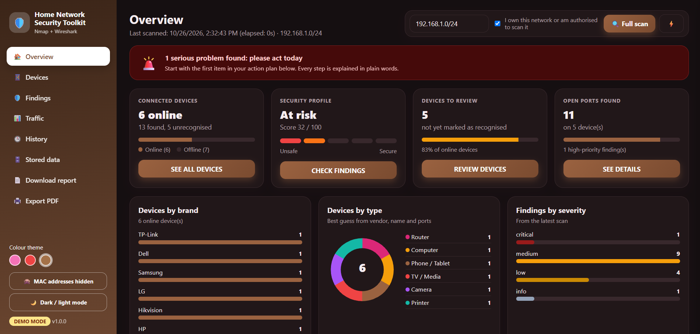
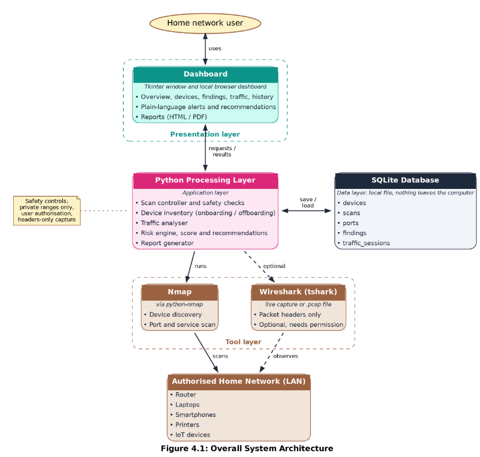
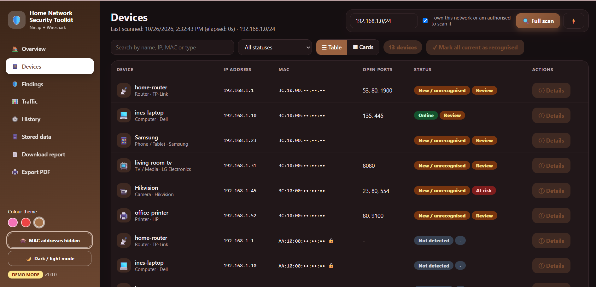
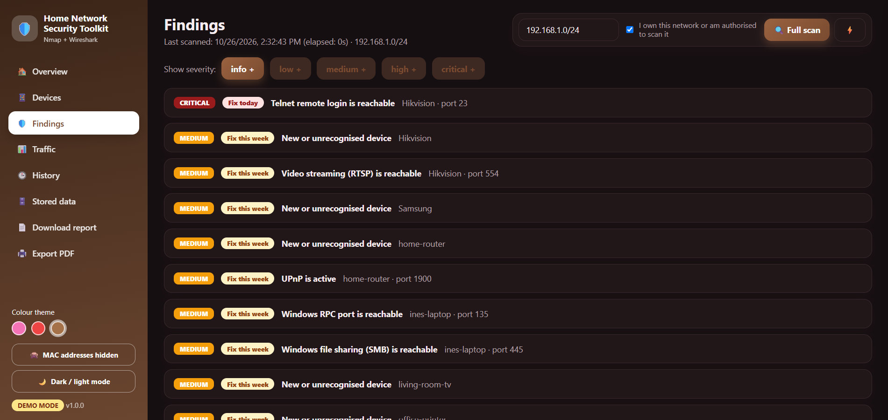
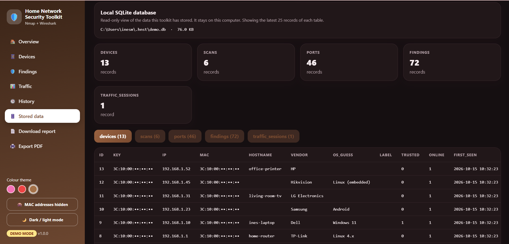

# Home Network Security Toolkit

A Python-based home network security tool that combines **Nmap** (device and port discovery) and **Wireshark's tshark engine** (optional traffic analysis) and explains the results in plain language for non-technical users.

> Final-year project, BSc Computer Networks and Cybersecurity, Strathmore University.
> Use only on networks you own or are authorised to assess.



## Features
- Finds devices on your home network (IP, MAC, hostname, manufacturer) and scans their open ports and services
- Tracks devices as New/Unrecognised or Not Currently Detected; records are never deleted automatically
- 20 port rules plus device and traffic rules, with five severity levels and a 0 to 100 security score
- Plain-language alerts: what it means, numbered steps to fix, time needed and priority
- Optional traffic analysis (packet headers only, never message content)
- Browser dashboard (rose, cherry and mocha themes, dark mode), desktop window, command line and HTML/PDF report
- Safety built in: private ranges only, authorisation confirmation, local-only storage

## How it works


## Quick start
1. Install Python 3.10+, [Nmap](https://nmap.org/download) and, for traffic analysis, [Wireshark](https://www.wireshark.org/download.html) (keep Npcap ticked).
2. In a terminal:
   ```
   python -m venv .venv
   .\.venv\Scripts\Activate.ps1
   pip install -r requirements.txt
   ```
3. Try it safely with simulated data: `python run.py --demo web`
4. Use it for real (run the terminal as administrator): `python run.py web`
5. Check your setup: `python run.py check`

## Tests
```
python -m unittest discover -s tests -v
```

## Screenshots
| Overview | Devices |
|---|---|
|  |  |
| **Findings** | **Stored data** |
|  |  |

## Project layout
```
hnst/        application code (scanner, traffic, risk, advice, database, web and desktop interface)
tests/       automated tests
docs/        diagrams, screenshots and test evidence
run.py       launcher
```

## Responsible use
Scan only networks you own or have written permission to test. The tool refuses public IP ranges and contains no exploitation features.

## Author
Ines M. Kornelio, Strathmore University.

## Acknowledgements
Built with Nmap, Wireshark, python-nmap, Matplotlib and Python's standard library.


## Licence and citation
MIT licence (see `LICENSE`). To cite, use the "Cite this repository" button on GitHub.